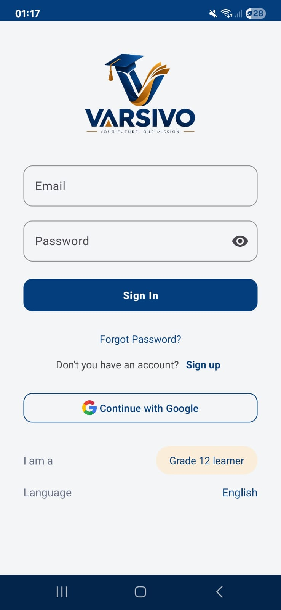
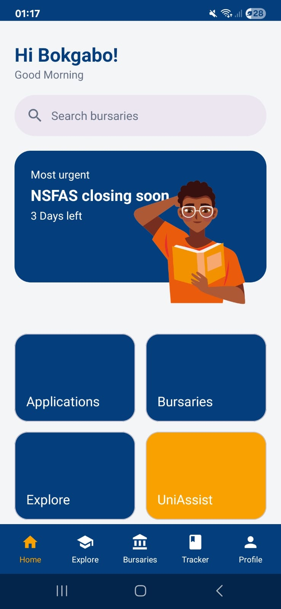

# Varsivo — Apply. Fund. Succeed.

<!-- TODO: replace <user>/<repo> with your GitHub repository to show the build badge -->
[](https://github.com/<user>/<repo>/actions/workflows/android.yml)

Varsivo is a South African mobile app that helps **Grade 12 learners** find universities, apply for them, discover
bursaries and check which institutions they qualify for — all in one place. A premium tier, **UniAssist**, supports
first-year students with their timetable and deadlines.

Built by **Team CyberSparks** for the **OPSC6312** WIL project (Part 2 – App Prototype Development).
Language: **Kotlin** · UI: **XML layouts + Android Views (no Jetpack Compose)**.

> 🎥 **Demo video:** `<!-- TODO: paste your unlisted YouTube link here -->`
>
> 👥 **Team:** `<!-- TODO: add the four team member names -->`

---

## 1. Purpose of the app

Matric learners in South Africa have to juggle university applications, bursary deadlines and subject requirements
across many websites. Varsivo puts the essentials in one app:

| Need | Varsivo feature |
|---|---|
| Find a university and apply | **Find Your University** list (public REST API), apply form, **map** of the campus |
| Pay for studies | **Bursaries** list from our hosted REST API, details and apply form |
| Know what I qualify for | **Explore** – APS calculator that matches the learner to institutions |
| Keep track of my applications | **Applications tracker** (offline-first, syncs to the cloud) |
| Settle in at university | **UniAssist** – timetable and deadlines (premium tier) |

## 2. Screenshots

<!-- TODO: add screenshots to docs/screenshots/ and link them, e.g. -->
<!--   -->

## 3. Features (and where to find them in the code)

| Feature | What it does | Code |
|---|---|---|
| **Register / Sign in** | Student ID + password. The password is **salted and hashed with PBKDF2-HMAC-SHA256** before it is saved or uploaded — the plain password is never stored. Validation messages for every field. | `LoginFragment`, `RegisterFragment`, `AuthRepository`, `SecurityUtils` |
| **Settings** | Edit name and school, choose language, switch notifications on/off, **change password**, log out. Saved on the phone and pushed to the online database. | `SettingsFragment` |
| **REST API (hosted)** | MockAPI project with `users`, `applications` and `bursaries` resources (see §6). | `api/` package |
| **API integration** | Retrofit + Gson calls from the app: register/login/update user, list bursaries, submit applications. | `RetrofitClient`, `*Api.kt` |
| **Bursaries** (user-defined 1) | List, search, "view more", details screen and apply form. | `BursariesFragment`, `BursaryDetailsFragment` |
| **Universities + Map** (user-defined 2) | Searchable list from the Hipo Labs Universities API; place name → coordinates with OpenStreetMap Nominatim; shown on a **MapLibre** map (external SDK). | `UniversitiesFragment`, `UniversityMapFragment` |
| **Applications tracker** (user-defined 3) | Local SQLite table, status chip (Pending → Submitted → Offer), delete, search, "Offline – will sync…" retry. | `ApplicationsTrackerFragment`, `ApplicationRepository`, `ApplicationsDb` |
| **APS calculator** (extra) | Converts marks to the 7-point scale, matches institutions. | `ExploreFragment`, `ApsCalculator` |
| **UniAssist** (extra) | Timetable and upcoming deadlines (prototype data). | `FirstYearSupportFragment` |

## 4. Design considerations

* **Android Views + XML, single Activity.** One `MainActivity` hosts a `NavHostFragment`; every screen is a Fragment
  declared in `res/navigation/nav_graph.xml`. The navy bottom bar is defined once in `activity_main.xml`.
* **View Binding** instead of `findViewById` for type-safe access to views (`BaseFragment` handles the binding lifecycle).
* **Material 3 components** (`TextInputLayout`, `MaterialButton`, `MaterialCardView`, dialogs, snackbars) with a custom
  navy `#053E7D` / gold `#F8A100` theme, shared styles in `styles.xml`, and consistent layout, fonts and colours.
* **Invalid input never crashes the app.** Every form validates with the pure functions in `Validators`, shows an
  error on the exact field, and clears it as soon as the learner edits it again. Network failures show a friendly
  message with a **Try again** button.
* **Offline-first.** Accounts and applications are saved on the phone first and then synced to the REST API. If the
  network is down the learner can still register, log in and apply; unsynced rows are flagged and retried.
* **Responsive to the keyboard and system bars** (edge-to-edge insets handled in `MainActivity`).
* **Separation of concerns:** Fragments (UI) → repositories (`AuthRepository`, `ApplicationRepository`) → data
  sources (SharedPreferences, SQLite, Retrofit). Logic that needs testing lives in plain Kotlin classes.

```
com.example.varsivo
├── MainActivity.kt · VarsivoApplication.kt · SecurityUtils.kt
├── api/        Retrofit interfaces + models (users, applications, bursaries, universities, geocoding)
├── data/       AuthRepository, ApplicationRepository, UserStore (SharedPreferences), ApplicationsDb (SQLite)
├── ui/         one Fragment per screen, BaseFragment, adapters/ (RecyclerView)
└── util/       Validators, ApsCalculator, BursaryFilter, PartOfDay
```

## 5. Security

* Passwords: 16-byte random salt + **PBKDF2WithHmacSHA256, 120 000 iterations, 256-bit hash** (`SecurityUtils`).
  Only the salt and hash are saved on the phone and in the online database.
* Hash comparison uses `MessageDigest.isEqual` (constant time).
* No API keys are committed; `local.properties` and `secrets.properties` are in `.gitignore`.

## 6. REST API and database

Hosted on **MockAPI** (`https://6aa34e30e7ae868cdf7aceb1.mockapi.io/`). The base URL is set in `RetrofitClient.kt`.

| Resource | Method & path | Used for |
|---|---|---|
| `users` | `POST /users` | Register (stores `studentId, name, schoolName, salt, passwordHash`) |
| | `GET /users?studentId=…` | Duplicate check and login on a new phone |
| | `PUT /users/{id}` | Settings: profile or password change |
| `applications` | `POST /applications` | Submit a university or bursary application |
| `bursaries` | `GET /bursaries` | Bursaries list (`name, description, provider, eligibility, closingDate`) |

> **Set-up note:** create the three resources in MockAPI with the fields above (the `applications` resource needs
> `studentId, type, institution, programme, status, applicantName, email, createdAt`).

External public APIs: [Hipo Labs Universities](http://universities.hipolabs.com/) and
[OpenStreetMap Nominatim](https://nominatim.org/). Map SDK: [MapLibre Native](https://maplibre.org/).

## 7. Automated testing

**46 JUnit tests** run on the JVM (no phone needed):

| Test class | What it proves |
|---|---|
| `AuthRepositoryTest` | Register hashes the password and syncs; offline registration; duplicate Student ID refused; login success / wrong password / unknown ID / login on a second phone; change password; profile update; logout |
| `ValidatorsTest` | Name, Student ID, password, email and mark rules |
| `ApsCalculatorTest` | Mark → point scale, APS scaling, eligibility |
| `BursaryFilterTest`, `BursaryTest` | Search/"view more" logic and safe handling of JSON nulls |
| `SecurityUtilsTest` | Hash/verify, unique salts, hash format |
| `PartOfDayTest`, `ApplicationStatusTest` | Greeting and status cycling |

Run locally: `./gradlew testDebugUnitTest` (report: `app/build/reports/tests/testDebugUnitTest/index.html`).

## 8. GitHub and GitHub Actions

* The project is version-controlled with Git on GitHub (commit and push regularly as features are added).
* **`.github/workflows/android.yml`** runs on every push and pull request: it sets up JDK 21, runs
  `./gradlew testDebugUnitTest`, builds `./gradlew assembleDebug`, and uploads the test report and the debug APK as
  build artifacts. A green badge at the top of this README means the tests pass and the app builds on a clean machine.

## 9. Logging

`android.util.Log` is used throughout (tags such as `AuthRepository`, `ApplicationRepository`, `SettingsFragment`,
`MainActivity`) to record logins, registrations, API results, sync retries and navigation. Filter **Logcat** by the tag
or by `package:com.example.varsivo` to follow the app while it runs.

## 10. How to run

1. Open the project in **Android Studio** (a recent version that supports AGP 9) and let Gradle sync.
2. Run on an emulator or a phone (minSdk 24).
3. Register a new account, then log in.

Requirements: JDK 21 (Android Studio's bundled JDK is fine) and an internet connection for the API features.

## 11. Known limitations

* The language drop-down saves the choice, but the isiZulu / Afrikaans translations are not included yet.
* "Forgot password" and "Continue with Google" are demo flows (a real reset needs an email service; real Google
  Sign-In needs an OAuth client).
* UniAssist timetable/deadlines use sample data.
* The universities API is plain HTTP, so cleartext traffic is enabled in the manifest.

## 12. Use of AI tools

> *Edit this section so it is accurate for your own work (maximum 500 words, with citations).*

Claude (Anthropic, 2026) was used to help convert the user interface from Jetpack Compose to XML layouts with Android
Views, to complete missing resource files, and to draft the unit tests, the GitHub Actions workflow and the structure of
this README. All generated code was reviewed, run and tested by the team. Prompts and outputs are available on request.

## 13. References

Android Developers (2024) *Navigation component*. Available at: https://developer.android.com/guide/navigation (Accessed: `<date>`).
Android Developers (2024) *View binding*. Available at: https://developer.android.com/topic/libraries/view-binding (Accessed: `<date>`).
Android Developers (2024) *Save data using SQLite*. Available at: https://developer.android.com/training/data-storage/sqlite (Accessed: `<date>`).
Anthropic (2026) *Claude* [Large language model]. Available at: https://claude.ai (Accessed: `<date>`).
GitHub (2025) *Automated build Android app with GitHub Action*. Available at: https://github.com/marketplace/actions/automated-build-android-app-with-github-action (Accessed: `<date>`).
Hipo Labs (2024) *Universities API*. Available at: http://universities.hipolabs.com/ (Accessed: `<date>`).
MapLibre (2025) *MapLibre Native for Android*. Available at: https://maplibre.org/maplibre-native/android/ (Accessed: `<date>`).
MockAPI (2025) *MockAPI*. Available at: https://mockapi.io/ (Accessed: `<date>`).
OpenStreetMap Foundation (2025) *Nominatim*. Available at: https://nominatim.org/ (Accessed: `<date>`).
Square (2024) *Retrofit*. Available at: https://square.github.io/retrofit/ (Accessed: `<date>`).
