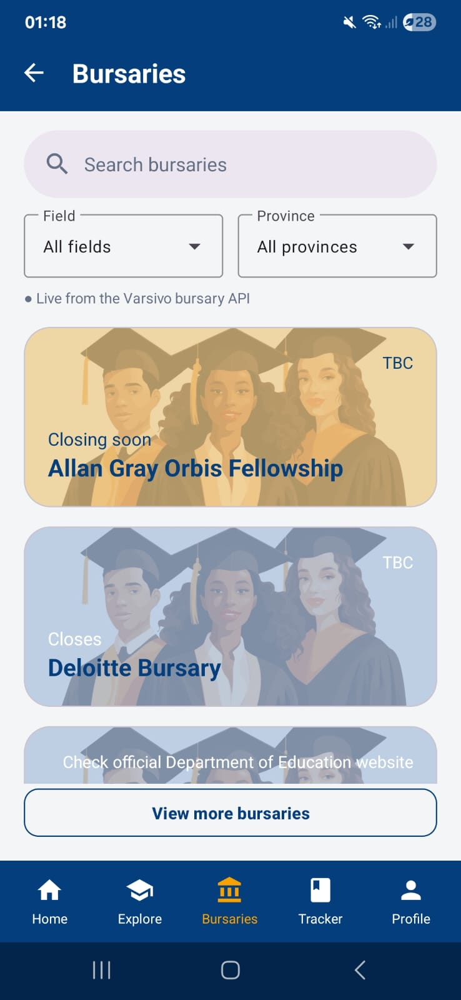
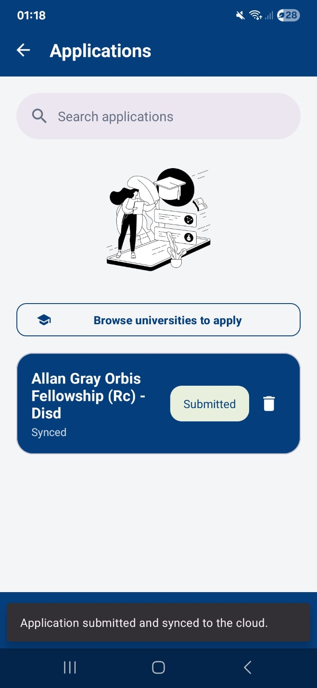
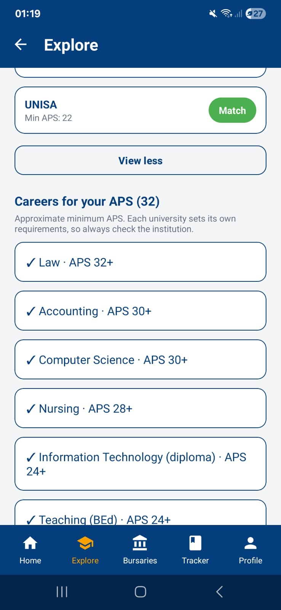
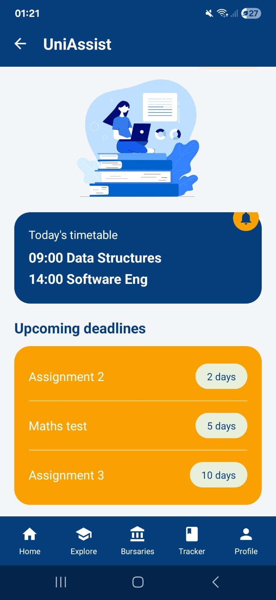
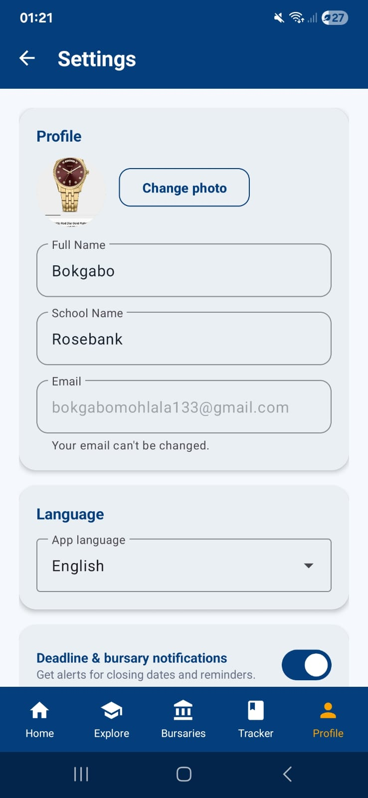
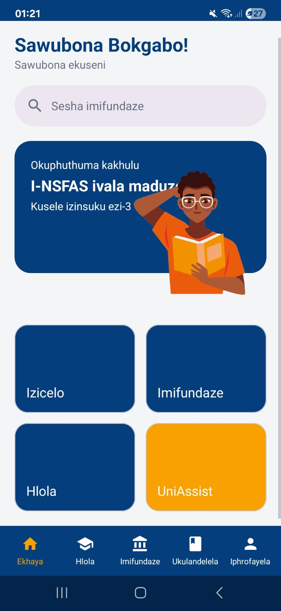
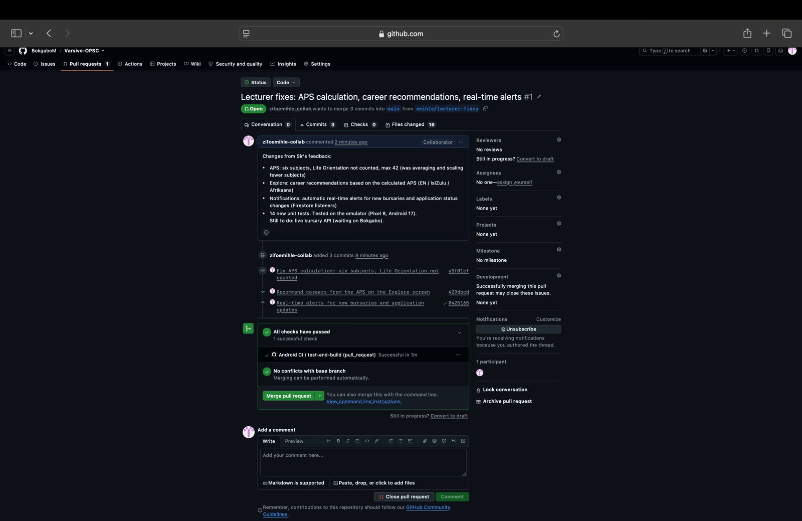

# Varsivo — Apply. Fund. Succeed.

[](https://github.com/BokgaboM/Varsivo-OPSC/actions/workflows/android.yml)

Varsivo is a South African Android app that helps **Grade 11 and 12 learners** work out which universities they
qualify for, find bursaries, keep track of their applications, and get first-year support once they are enrolled.

OPSC6312 Portfolio of Evidence (Part 2: App Prototype, Part 3: Final App).
Language: **Kotlin** · UI: **XML layouts + Android Views** (no Jetpack Compose anywhere in the project).

> 🎥 **Demo video:** `<!-- TODO: paste the unlisted YouTube link here -->`
>
> 👥 **Team (Group 7 – CyberSparks):** Bokgabo Mohlala (ST10440136), Emihle Zifo (ST10452317), Mampe Shaan Motsholane (ST10437865), Keletso Hope Thamaga (ST10456948)

---

## 1. Purpose of the app

Matric learners have to juggle university applications, bursary deadlines and subject requirements across many
websites. Varsivo puts the essentials in one app:

| Learner need | Varsivo feature |
|---|---|
| Do I qualify? | **Explore**: APS calculator that converts marks to the 7-point scale and matches institutions |
| How do I pay for it? | **Bursaries**: searchable list from the Cloud Firestore database, filtered by field and province |
| Where did I apply? | **Tracker**: offline-first application tracker that syncs to the cloud |
| Which universities exist? | **Find your university**: public universities API with a map |
| How do I survive first year? | **UniAssist** (premium): timetable and deadlines, unlocked with a verified university or college email (`.ac.za` or `.edu.za`) |

## 2. Screenshots

| Login | Home | Bursaries | Tracker |
|---|---|---|---|
|  |  |  |  |

| APS calculator | UniAssist | Settings | isiZulu |
|---|---|---|---|
|  |  |  |  |

## 3. Features and where they are in the code

| Feature | What it does | Code |
|---|---|---|
| **Register and log in** | Email + password with Firebase Authentication. Firebase stores passwords as salted scrypt hashes; the phone keeps only a salted **PBKDF2-HMAC-SHA256** hash (120 000 iterations) for offline login. Clear errors for a wrong password, an email already in use and no connection. | `LoginFragment`, `RegisterFragment`, `AuthRepository`, `FirebaseAuthService`, `SecurityUtils` |
| **Onboarding choices** | Role (Grade 11 learner / Grade 12 learner / University student) and language, picked on the login screen and saved to the profile. | `LoginFragment`, `UserStore` |
| **Forgot password** | Firebase emails a real reset link. | `LoginFragment`, `AuthRepository.sendPasswordReset` |
| **Settings** | Name, school, language, notifications and password change. Saved on the phone (SharedPreferences) and in Firestore `users/{uid}`; offline changes upload automatically later. | `SettingsFragment`, `AuthRepository.updateSettings` |
| **Bursary database** (user-defined 2) | Loaded **live from our REST API** (MockAPI `GET /bursaries` through Retrofit), with the Firestore `bursaries` collection as the backup when the API is unavailable; the screen shows which source is in use. Search by name or provider, filter by study field and province. | `BursariesFragment`, `BursaryRepository`, `BursaryApiService`, `BursaryFilter` |
| **APS calculator** (user-defined 1) | Six labelled subjects (Home Language, First Additional Language, Maths or Maths Literacy, three electives); each mark (0–100) is converted to the 7-point scale and added up. Life Orientation is not counted; maximum 42. Shows which institutions the learner qualifies for and **recommends careers** for that APS (plus careers a few points away). | `ExploreFragment`, `ApsCalculator`, `CareerAdvisor` |
| **Application tracker** (user-defined 3, offline mode) | Applications, status changes and deletes are saved to SQLite first, then synced to Firestore `users/{uid}/applications`. Offline changes show "Offline – will sync…" and upload when the tracker opens again. | `ApplicationsTrackerFragment`, `ApplicationRepository`, `ApplicationsDb`, `FirestoreApplicationRemote` |
| **UniAssist (premium)** (user-defined 4) | Locked until the student enters a university or college email (`.ac.za`, `.edu.za` such as the IIE's `vcconnect.edu.za`, or an allowed college domain); look-alikes such as `uj.ac.za.fake.com` are refused; the flag is stored on the phone and in Firestore. | `FirstYearSupportFragment`, `UniAssistRepository` |
| **Universities + map** (user-defined 5) | Hipo Labs Universities API (Retrofit), OpenStreetMap Nominatim for coordinates, shown on a MapLibre map. | `UniversitiesFragment`, `UniversityMapFragment` |
| **Three languages** | English, isiZulu and Afrikaans for every screen; switch on the login screen or in Settings. | `res/values`, `res/values-zu`, `res/values-af`, `AppLanguage` |
| **Single sign-on (Google)** | "Continue with Google" through Android Credential Manager; the Google ID token is exchanged for a Firebase account. | `LoginFragment`, `AuthRepository.loginWithGoogle`, `FirebaseAuthService` |
| **Push notifications** | Firebase Cloud Messaging. Phones subscribe to the `bursary-alerts` topic while notifications are on in Settings, so one message reaches every student in real time. Android 13+ asks for permission first. **Automatic real-time alerts** (Firestore listeners): "New bursary" when a bursary is added to the database, and "Application update" when an application's status changes outside the phone. | `PushNotifications`, `VarsivoMessagingService`, `RealtimeAlerts`, `HomeFragment` |
| **Profile photo (blob storage)** | Chosen in Settings, compressed, and stored in an Azure Blob Storage container; loaded again when Settings opens. | `SettingsFragment`, `ProfilePhotoRepository`, `AzureBlobStorage` |
| **App icon and store assets** | New launcher icon, 512 × 512 Play Store icon and 1024 × 500 feature graphic. | `res/mipmap-*`, `docs/play-store/` |

## 4. Design considerations

* **Views and XML only, single Activity.** `MainActivity` hosts a `NavHostFragment`; every screen is a Fragment in
  `res/navigation/nav_graph.xml`. View Binding replaces `findViewById`, and `BaseFragment` clears the binding in
  `onDestroyView` so screens never leak views.
* **Bottom navigation:** Home | Explore | Bursaries | Tracker | Profile, defined once in `activity_main.xml`; the
  current tab is highlighted in gold.
* **Brand:** navy `#053E7D` and gold `#F8A100` Material 3 theme, shared styles in `styles.xml`, matching the Figma
  design.
* **Invalid input never crashes the app.** Every form validates with the pure functions in `Validators`, shows the
  error on the exact field and clears it while the user types. Every network call has a timeout and a friendly message.
* **Offline first.** The last account can log in without internet (local PBKDF2 hash), the tracker works fully
  offline, and Firestore queues profile and settings writes until the phone reconnects.
* **Separation of concerns:** Fragments (UI) → repositories → data sources (SharedPreferences, SQLite, Firebase,
  Retrofit). The online sign-in sits behind the `AuthService` interface so the logic is unit-tested with a fake.
* **Security:** passwords are never stored in plain text; Firestore security rules only let a signed-in user read
  and write their own `users/{uid}` documents.

```
com.example.varsivo
├── MainActivity · VarsivoApplication · SecurityUtils
├── api/   Retrofit clients and models (bursary model, universities, geocoding)
├── data/  AuthRepository, AuthService + FirebaseAuthService, BursaryRepository, ApplicationRepository,
│          ApplicationsDb (SQLite), UserStore (SharedPreferences), UniAssistRepository
├── ui/    one Fragment per screen, BaseFragment, adapters
└── util/  Validators, ApsCalculator, BursaryFilter, AppLanguage, PartOfDay
```

## 5. Online services and database

| Service | Used for |
|---|---|
| **Firebase Authentication** | Accounts (email + password) and password-reset emails |
| **Cloud Firestore** (NoSQL) | `users/{uid}`: profile, role, language, notifications, UniAssist flag · `users/{uid}/applications`: tracker · `bursaries`: bursary database |
| **MockAPI (our REST API)** | `GET /bursaries`: the live bursary list |
| **Hipo Labs Universities API** | List of South African universities |
| **OpenStreetMap Nominatim** | University name → map coordinates |
| **Firebase Cloud Messaging** | Push notifications (topic `bursary-alerts`) |
| **Azure Blob Storage** | Profile photos (one blob per user) |

Firebase project settings are in `app/src/main/res/values/firebase.xml` (copied from `google-services.json`).

## 6. Automated testing

JUnit tests run on the JVM, with no phone needed:

| Test class | What it proves |
|---|---|
| `AuthRepositoryTest` | Register (hash on phone, profile online, role and language sent), duplicate email, offline register; login online, offline, wrong password, unknown email, on a second phone; Google sign-in profile; password reset; change password; settings online and offline; logout |
| `ValidatorsTest` | Name, email, password, mark and student-email rules (`.ac.za`, `.edu.za`, allowed colleges, look-alike domains refused) |
| `ApsCalculatorTest` | Mark → points, six subjects required, worked example (APS 32), minimum and maximum, eligibility |
| `CareerAdvisorTest` | Careers recommended for an APS, "almost" careers within 3 points, ordering |
| `BursaryRepositoryTest` | Live API used first; falls back to the database when the API fails or is empty |
| `RealtimeAlertRulesTest` | When a status change should (and should not) trigger an alert |
| `BursaryFilterTest` | Search, field filter, province filter, "View more" |
| `BursaryTest`, `SecurityUtilsTest`, `PartOfDayTest`, `ApplicationStatusTest` | JSON nulls, hashing, greeting, status cycling |

Run locally: right-click `com.example.varsivo (test)` → **Run Tests**, or `./gradlew testDebugUnitTest`.

## 7. GitHub and GitHub Actions

* The project is version-controlled with Git and pushed to GitHub after each feature.
* `.github/workflows/android.yml` runs on every push and pull request: it sets up JDK 21, runs
  `./gradlew testDebugUnitTest`, builds `./gradlew assembleDebug`, and uploads the test report and the debug APK as
  build artifacts. The badge at the top shows the latest result.



## 8. Logging

`android.util.Log` is used throughout (tags such as `AuthRepository`, `FirebaseAuthService`, `BursaryRepository`,
`ApplicationRepository`, `UniAssist`, `AppLanguage`, `MainActivity`) to record logins, sync results, offline
fall-backs and navigation. Filter Logcat by `package:za.co.varsivo.app` to follow the app.

## 9. How to run

1. Open the project folder (the one containing `app/`) in Android Studio and let Gradle sync.
2. Connect an Android phone (USB debugging on) and press **Run**. Minimum Android 7.0 (API 24).
3. Register with an email and password, then log in.

## 10. Release notes

### Part 2 rebuild (November 2026)
* Rebuilt the whole UI with **XML layouts and Android Views**; Jetpack Compose removed.
* **Firebase Authentication** for register, login, logout and password reset; **Cloud Firestore** for profiles and
  settings (replacing the earlier MockAPI users table).
* Role and language chosen at onboarding.
* Bursaries moved to **Firestore**, with **field and province filters** and search by provider.
* Tracker status changes and deletes now **sync to the cloud**, with offline queueing.
* **UniAssist** locked behind student-email verification (`.ac.za`, `.edu.za` and allowed college domains).
* New bottom navigation: Home | Explore | Bursaries | Tracker | Profile.
* **isiZulu and Afrikaans** translations for every screen.
* App ID changed to `za.co.varsivo.app` (Play Store ready).
* Unit tests rewritten for Firebase; GitHub Actions builds and tests every push.

### Part 3 (final PoE)
Version **2.0** (`versionCode 2`), application ID `za.co.varsivo.app`.

**New innovative features**
* **Single sign-on with Google** – learners can sign in with their Google account instead of creating a password.
* **Real-time push notifications** – Firebase Cloud Messaging alerts for bursary news and deadlines; the Settings
  switch subscribes or unsubscribes the phone, and Android 13+ asks for permission.
* **Profile photos in the cloud** – stored in Azure Blob Storage, so the photo follows the student to a new phone.

* **Career recommendations from the APS** – after calculating, Explore lists the careers the learner qualifies for
  and the ones a few points away (suggested by our lecturer).
* **Live bursary API** – the bursary list now comes live from our hosted REST API (MockAPI, through Retrofit),
  with Firestore as the offline backup (suggested by our lecturer).
* **Automatic real-time alerts** – Firestore listeners notify students the moment a new bursary is added or an
  application's status changes, without anyone sending a message by hand (suggested by our lecturer).

**Other updates since the prototype**
* **APS calculation corrected** (lecturer feedback): it now adds the points of six subjects and leaves out Life
  Orientation (maximum 42). The old version averaged the marks entered and scaled them up, so three marks of 80%
  gave the maximum.
* Offline mode with sync: the application tracker works without internet (SQLite) and uploads changes to Firestore
  when the connection returns.
* Multi-language support: isiZulu and Afrikaans on every screen, switchable at any time.
* New app icon and final image assets; Play Store icon and feature graphic in `docs/play-store/`.
* Signed release build with the team's upload key, ready for the Google Play Store.
* Lecturer feedback applied: the first Part 2 attempt lost marks for using Jetpack Compose, so the whole UI was
  rebuilt with XML layouts and Android Views. Invalid input is handled on every form without crashing.

## 11. Use of AI tools

See [docs/AI_USE.md](docs/AI_USE.md).

## 12. References

Android Developers (2024) *Navigation component*. Available at: https://developer.android.com/guide/navigation (Accessed: 3 November 2026).
Android Developers (2024) *View binding*. Available at: https://developer.android.com/topic/libraries/view-binding (Accessed: 3 November 2026).
Android Developers (2024) *Save data using SQLite*. Available at: https://developer.android.com/training/data-storage/sqlite (Accessed: 3 November 2026).
Android Developers (2024) *Per-app language preferences*. Available at: https://developer.android.com/guide/topics/resources/app-languages (Accessed: 3 November 2026).
Anthropic (2026) *Claude* [Large language model]. Available at: https://claude.ai (Accessed: 3 November 2026).
Firebase (2026) *Authenticate with Firebase using password-based accounts on Android*. Available at: https://firebase.google.com/docs/auth/android/password-auth (Accessed: 3 November 2026).
Firebase (2026) *Add data to Cloud Firestore*. Available at: https://firebase.google.com/docs/firestore/manage-data/add-data (Accessed: 3 November 2026).
Firebase (2026) *Get data with Cloud Firestore*. Available at: https://firebase.google.com/docs/firestore/query-data/get-data (Accessed: 3 November 2026).
Firebase (2026) *Get realtime updates with Cloud Firestore*. Available at: https://firebase.google.com/docs/firestore/query-data/listen (Accessed: 4 November 2026).
GitHub (2025) *Automated build Android app with GitHub Action*. Available at: https://github.com/marketplace/actions/automated-build-android-app-with-github-action (Accessed: 3 November 2026).
Hipo Labs (2024) *Universities API*. Available at: http://universities.hipolabs.com/ (Accessed: 3 November 2026).
MapLibre (2025) *MapLibre Native for Android*. Available at: https://maplibre.org/maplibre-native/android/ (Accessed: 3 November 2026).
OpenStreetMap Foundation (2025) *Nominatim*. Available at: https://nominatim.org/ (Accessed: 3 November 2026).
OWASP (2024) *Password Storage Cheat Sheet*. Available at: https://cheatsheetseries.owasp.org/cheatsheets/Password_Storage_Cheat_Sheet.html (Accessed: 3 November 2026).
Square (2024) *Retrofit*. Available at: https://square.github.io/retrofit/ (Accessed: 3 November 2026).
ZA Bursaries (2026) *Calculate your APS score for university entrance*. Available at: https://www.zabursaries.co.za/aps-score-for-university-entrance/ (Accessed: 4 November 2026).
